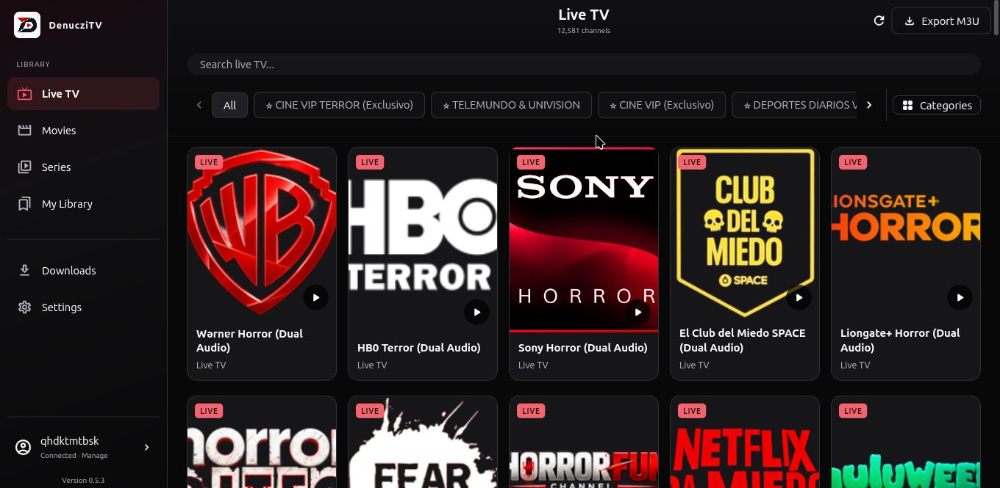
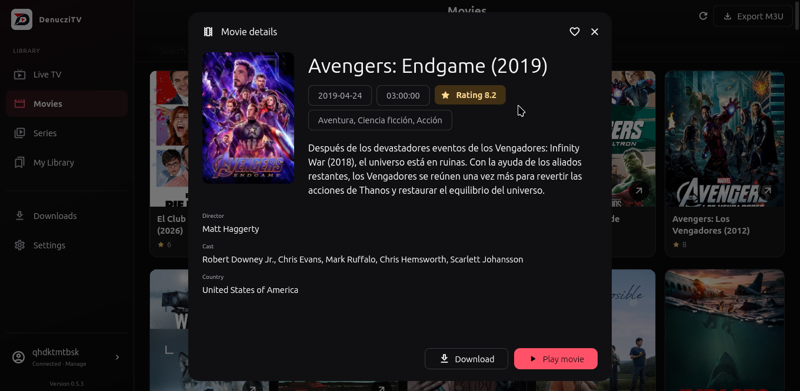
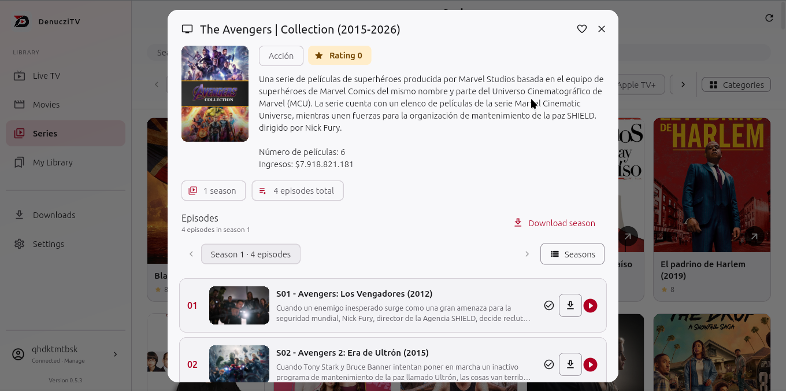

# DenucziTV

An open-source IPTV player for Linux and Windows, using your own Xtream-compatible provider account.

**[Download a pre-release](https://github.com/denuczi/DenucziTV/releases)**

Published **Linux `.deb` installers** are listed under each release's **Assets**.
You do not need Flutter or a compiler to install one. Choose the `.deb` file;
GitHub's **Source code** ZIP and TAR archives are for developers.

The current source and package version is **0.6.1**. The repository may contain
changes ahead of the published installers; check Releases for available downloads.

This is a pre-release under active development. DenucziTV does not include
channels, movies, subscriptions, or provider accounts.

## Install

### Linux: Debian package

1. Open [Releases](https://github.com/denuczi/DenucziTV/releases), choose the
   newest published Linux pre-release, and expand **Assets**.
2. Download its `.deb` and matching `.deb.sha256` file for an x86-64 Linux system.
   The 0.6.1 package is named `denuczitv_0.6.1+1-1_amd64.deb`.
3. Open a terminal in the folder containing the downloaded file and run:

   ```bash
   sha256sum -c denuczitv_0.6.1+1-1_amd64.deb.sha256 &&
   sudo apt install ./denuczitv_0.6.1+1-1_amd64.deb
   ```

   These commands use the 0.6.1 filenames. If you downloaded another version,
   substitute the filenames from that release.

4. Launch **DenucziTV** from your application menu, or run `denuczitv`.

Installation has been checked on **Debian 13 amd64**. The 0.6.1 Linux release
build and all 13 packaging checks passed on the maintainer's machine. Other
Debian/Ubuntu versions must satisfy the package's native library requirements;
compatibility with older releases is not guaranteed. See [Debian package details](docs/DEBIAN_PACKAGING.md)
for dependencies, verification, and removal.

### Windows

The project includes a Windows desktop runner. Check the selected release's
Assets for available platforms; the `.deb` package is for Linux. Developers can
follow the [Windows build instructions](docs/DEVELOPMENT.md#windows).

## Start using the app

1. Add a manual **Xtream** account with the provider's server address, username,
   and password, or select **Protected Single Link** and enter a name and the
   provider's permanent link. Protected Single Link requires version 0.6.0 or newer.
2. Browse **Live TV**, **Movies**, or **Series**, depending on your subscription.
3. Use **Settings** to choose the appearance and language, and enable download
   controls. Stream-link copying and M3U export are available for manual Xtream
   accounts. Protected accounts show these settings as unavailable with an
   explanation, while preserving your preferences for manual accounts.

Use only services and content you are authorized to access. Exported M3U files
and copied stream URLs can contain account credentials; keep them private.

## Features

- Multiple saved provider accounts with account details and reconnection.
- Protected Single Link connections with automatic credential renewal and
  effective link expiry; see the [connection guide](docs/PROTECTED_SINGLE_LINK.md).
- Live TV, movies, series, category filters, and catalog search.
- Catalogs loaded by section for both connection methods, with reuse of visited
  sections during the connection.
- Video playback with audio and subtitle selection when the stream supports it.
- Downloads with automatic reconnection and resume when supported by the provider.
- Localized download states and retry guidance, with distinct information,
  success, and error colors.
- Favorites, Continue Watching, and Watch History, stored locally per account.
- Light, dark, and system appearance; English and Spanish interfaces.
- Optional M3U export and stream-link copying for manual Xtream accounts.
- A configurable User-Agent for provider, playback, and download requests.

Playback, available tracks, and seeking depend on the provider and native media
libraries. Live TV does not support watch-history resume. Favorites and history
are not synchronized between devices. Each protected-account renewal starts a
new catalog generation. Earlier history and favorites are retained as unavailable
entries instead of being reassigned by ID or title. See
[personal-library behavior](docs/PERSONAL_LIBRARY.md) and the
[protected connection guide](docs/PROTECTED_SINGLE_LINK.md).

## Screenshots

### Live TV



### Movie details



### Series and episodes



Screenshots were captured in 0.5.3 and may differ from the current interface.
They show provider-supplied catalog information; DenucziTV does not supply the
content shown.

## Documentation and development

| Goal | Guide |
| --- | --- |
| Set up the project, build from source, or understand the architecture | [Development guide](docs/DEVELOPMENT.md) |
| Submit a change or report a bug | [Contributing](CONTRIBUTING.md) |
| Understand favorites, history, and playback progress | [Personal library](docs/PERSONAL_LIBRARY.md) |
| Understand protected connections, renewal, expiry, and data migration | [Protected Single Link](docs/PROTECTED_SINGLE_LINK.md) |
| Build or inspect a Debian package | [Debian packaging](docs/DEBIAN_PACKAGING.md) |
| Run release checks | [Quality assurance](docs/QA.md) |
| Report a vulnerability or review credential handling | [Security policy](SECURITY.md) |
| Read the change history | [Changelog](CHANGELOG.md) |

For bugs and feature requests, use [GitHub Issues](https://github.com/denuczi/DenucziTV/issues).
Documentation, issues, and pull requests use standard English; application
translations are maintained separately.

## License

Released under the [MIT License](LICENSE). Third-party dependencies retain their
respective licenses. Created by Ignacio Sanguina.
